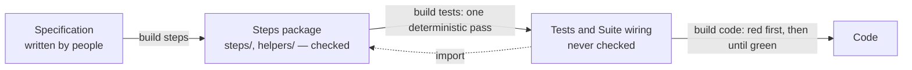

# Steps first, then tests, then code

TrueBDD tests nothing: from the Specification it generates the steps, then the tests, then the code, and the tests define what the code must be. During #293's grilling on 3 November the Owner fixed the order of the two commands that write a suite and what each owns, reversing ADR-0031's order.

We decided:

- **The order is `us refine`, `us apply`, `build steps`, `build tests`, `build code`.**
- **`build steps` writes the Steps package and nothing else:** a suite's `steps/` and the `helpers/` its steps need. It is the one generated part of a suite that is checked: Step coverage, compilation, one binding per step, written bodies and the critique. It never renders a test.
- **`build tests` renders the rest of the suite's folder deterministically, in one pass:** one test per Scenario and the Suite wiring, which import the Steps package. A test states its Scenario's steps literally over that package, so it is bound by construction and never checked; `build tests` keeps only the folder checks ADR-0038 gave it.
- **Red without the target is `build code`'s first step.** While no code is built every test is red, because the code does not exist. The run first lists every Scenario's test, then runs the suite without the target; a test that passes has steps doing the product's work, and they go back to `build steps`. Only then does `build code` write code.

This reverses ADR-0031's order and moves its test listing and red check, which ADR-0035 kept in `build steps`, to `build code`. It amends ADR-0038: the Suite wiring is `build tests`' output, since ADR-0038's reason for giving it to `build steps` (`build tests` ran first and read no definitions) is gone once steps come first.

## Considered Options

- **`build steps` renders the tests into its scratch copy to run the red check there:** withdrawn; `build steps` writes only steps.
- **Drop the red check and rely on the critique's `computes_assertion` finding:** only a run catches a step doing the product's work, a model only judges it.
- **`build steps` runs the Scenarios straight from the Registry:** a second way to run a Scenario beside its generated test.

## Consequences

- The Specification states the old order and must change with the engine: the `build steps`, `build tests` and `build code` entries of `docs/architecture/true-bdd-cli.yaml`, `docs/product/product.yaml`, the Story `docs/product/stories/build-steps-writing.yaml` and its Scenarios `build-steps-writing-001`, `-006` and `-007` (the red check) and `-008` and `-009` (the Suite wiring), with their fixtures re-recorded.
- The drill runs `build steps --fix` before `build tests --fix` (`docs/agents/drill.md`).

Grilling log: `docs/qna/20261103-072335-testkit-split.yaml`, the entry recording the Owner's order corrections after Q14, Q15, and the entries Claude settled as forced consequences (the Suite wiring and the test listing).
