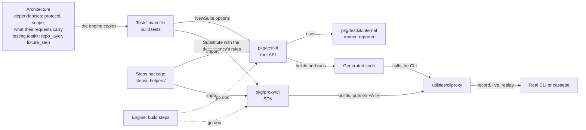

# The test runtime knows no product

Issue #293 found the critique of a step body needing `pkg/testkit`'s source: the Concept bindings retold what the test library does for TrueBDD alone, so a body that only called `PrepareTree` could not be judged without it. Its code run embedded the testkit files whole, 141,414 bytes for one suite, and every critique outgrew the prompt limit. During #293's grilling on 3 November the Owner rejected whole source files in prompts and drew the runtime anew: generic, the same for every Host project, fed by the product's Specification and never the other way.

We decided:

- **`pkg/testkit` holds only what is the same for every Host project** (Q1): generic mechanisms and TrueBDD's knowledge as the framework every host uses (its `true-bdd/` configuration, the Registry, the fixture layout, `llm:` and `judge:`). What holds only because the system under test is TrueBDD's engine leaves it; in a file mixing both, the mechanism stays and the values leave.
- **A CLI stand-in is an SDK and a utility** (Q2 to Q7): `pkg/proxy/cli` is the SDK the tests' main file calls, `utilities/cliproxy/` the binary, in its own module `github.com/ondatra-ai/true-bdd/utilities`, a fifth Go root. The SDK builds the binary from the commit the host's `pkg` came from, through a temporary `go.work` when `pkg` is a local copy, and puts it first on `PATH` under each CLI's name; the host declares nothing for it. One SDK per protocol, and only the CLI protocol for now; HTTP and the others wait for an application that needs them.
- **The architecture says which CLIs get a stand-in** (Q16): every dependency with `protocol: cli` and `scope: third_party`. `testing.testkit.ai_clis` is retired.
- **A product's facts flow from its Specification into the runtime** (Q14): a dependency declares the parts of its requests that change between runs, the paths a recording leaves out and the marker of a read-only request; the tests' main file passes them to the SDK, and cliproxy applies them. The values testkit needs for one host, its repository layer and the fixture step's pattern, are declared under `testing.testkit` and copied into the tests' main file (Q10).
- **Helpers are the steps' own code** (Q11, Q12): the writer puts what its steps share in `tests/<suite>/helpers/`, declared nowhere. testkit offers general hooks, such as one run on the assembled tree before the snapshot, through which the narrowed-checklist Given narrows its checklist.
- **Step bodies use only the `pkg/testkit` root and the SDK** (Q13): `runner` and `reporter` move under `pkg/testkit/internal/`, `Proxy` and `Harness` become unexported, and testkit gains small methods for what the steps do today (the next run's environment and `PATH`, the mode, its own result type); the SDK exposes what a stand-in observed.
- **The AI learns that API from `go doc`** (Q9): the engine runs `go doc` on the version the host's module graph resolves and gives it to the body turns and the critique. A function's meaning is its doc comment, written as a meaning. There is no catalogue file, and no prompt embeds whole source files.
- **Concept bindings state only what their steps mean**, through the Public interface and that API; the fixture lifecycle is testkit's and is no longer retold in them.
- **cliproxy records what it was handed at spawn, in every mode,** and the writer-spawn checks become Then steps. A real CLI that a signal ends while recording fails the recording loudly and nothing is recorded, since the engine waits for every CLI to exit by itself (Q18). The judge names the command with the suite's service name.
- **This repository's tooling leaves the runtime** (Q17): `reporter` but its generic `ContainedFile`, `reportserver`, `cmd/report-server` and `cmd/coverage` move to `scripts/`; `materializer`, whose caller and fixture format are gone, is deleted.

[The generation architecture](generation-architecture.md) draws this runtime in the whole pipeline.

This amends ADR-0038, whose harness lived whole in the test library: product knowledge now sits in the Specification and the steps' helpers, and tooling in `scripts/`. It amends ADR-0039's critique transport: the critique embeds the `go doc` of the runtime beside the suite source. Of #293's code run only the Glob fix and the evidence-root deduplication remain.

## Considered Options

- **Embed testkit files selected by direct use:** whole files either way, and every critique still near the limit.
- **A catalogue file of the API** (Q8): `go doc` of the host's version says the same and never goes stale (Q9).
- **A utility the AI turns call for their evidence:** researched, not pursued now; retrieved bytes escape the prompt limit and replay never re-runs it.
- **One SDK and utility per vendor:** more change than one per protocol, the shape the proxy already has (Q4).
- **The utility inside the root module:** `go install` refuses a module with a `replace`, and a host would download the tests and fixtures (Q7).
- **Helpers declared in the Specification:** they are the steps' own code (Q11).

Grilling log: `docs/qna/20261103-072335-testkit-split.yaml`, Q1 to Q18, the entry Claude was delegated in Q4, and the entries Claude settled as forced consequences.
