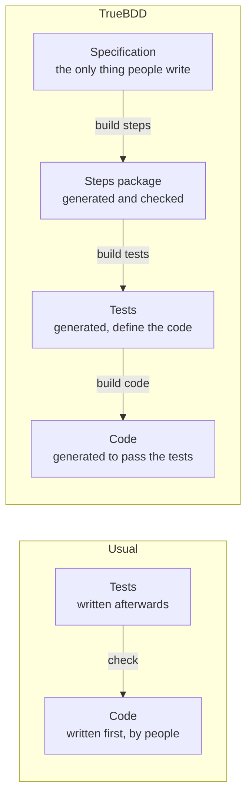
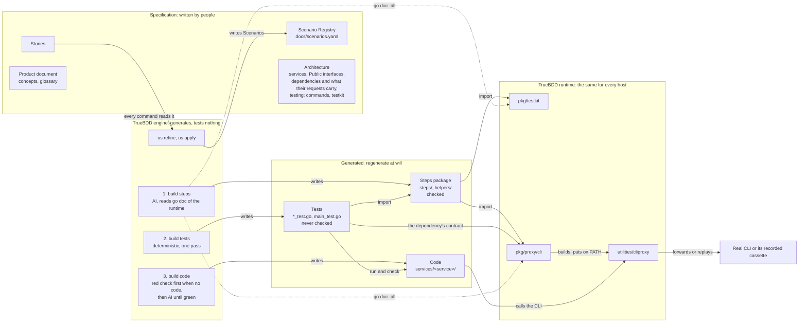
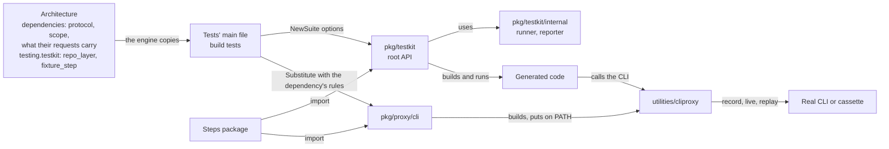

# TrueBDD's generation architecture

TrueBDD tests nothing. From a Host project's Specification it generates the Steps package, then the tests that import it, then the code those tests demand. The tests define what the code must be; the code has no authority of its own, and only the Steps package is checked. This is the living picture behind ADR-0040 and ADR-0041; `.claude/rules/generation.md` states the same rules for work on the repository, and [the published page](https://claude.ai/artifact/SYhGb7WK9jaN6Bu2Lex6HH) draws it.

## The direction is reversed

Tests are not written to check code that already exists. The steps come first, the tests are rendered from the Scenarios on top of them, and the code is generated until those tests pass.

## What generates what, and what is checked

- `build steps` writes the Steps package, the one generated thing that is checked: Step coverage, compilation, one binding per step, written bodies and the critique, which also reads the helpers.
- `build tests` renders one test per Scenario and the tests' main file, `main_test.go` (`TestMain`, the suite, `New`), in one deterministic pass; the tests are bound to the steps by construction and never checked. Without the Steps package it refuses to start.
- `build code` writes the code. When a service has no code yet, it first runs that service's tests: every one must be red, because the code does not exist; a green test stops it, naming its Scenario. With code present, it goes on to the failing tests.

## The runtime knows no product

A product's facts flow one way, from its Specification into the runtime. The architecture declares each third-party dependency and what its requests carry; the tests' main file passes that to the SDK, which hands it to `cliproxy`. `pkg/testkit`, `pkg/proxy/cli` and `utilities/cliproxy` hold only what is the same for every Host project; step bodies see the `pkg/testkit` root and the SDK alone, and the AI learns them from `go doc -all`.
