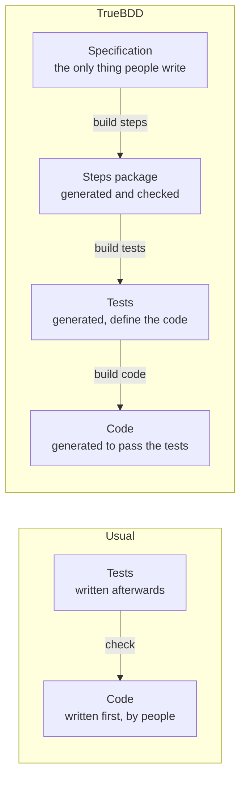
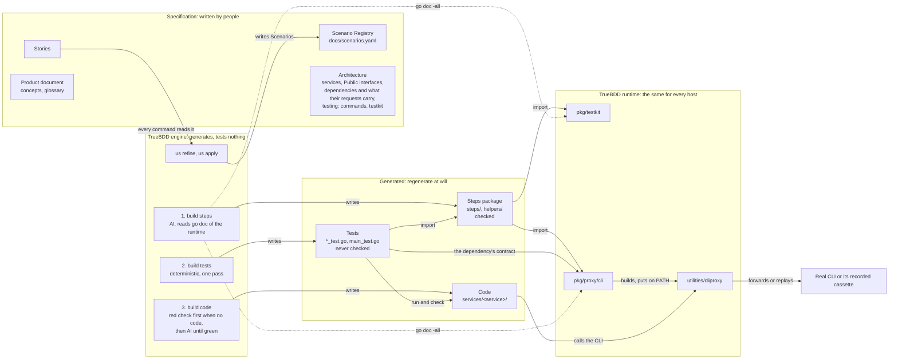
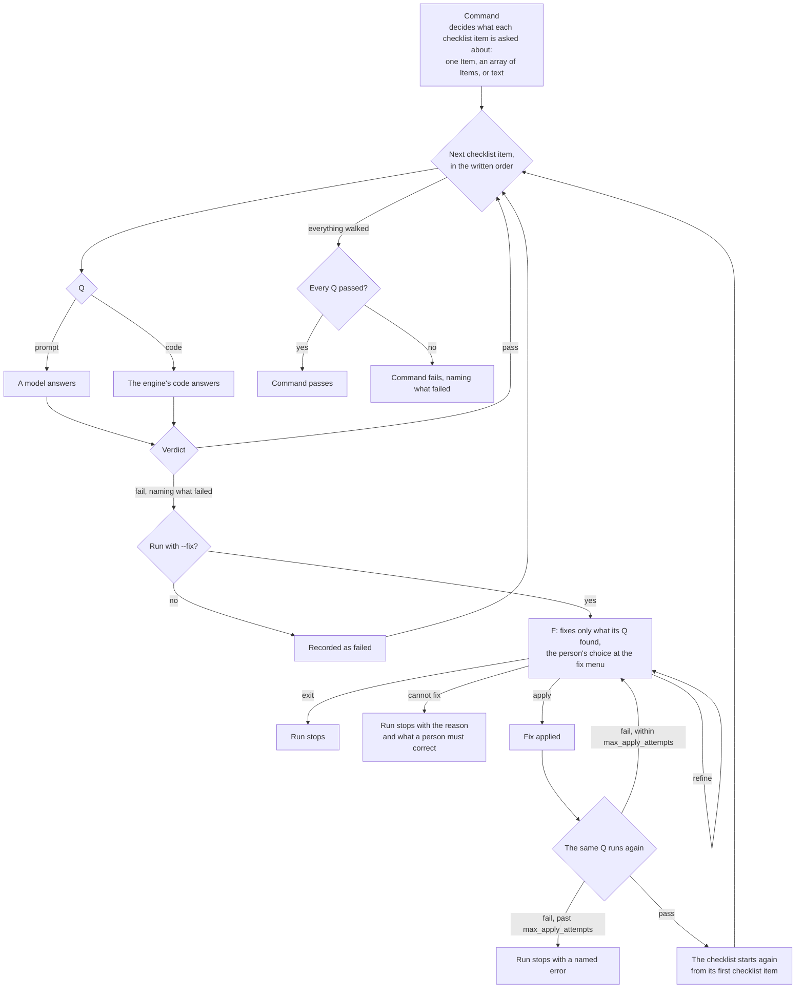
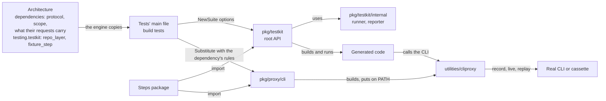

# TrueBDD's generation architecture

TrueBDD tests nothing. From a Host project's Specification it generates the Steps package, then the tests that import it, then the code those tests demand. The tests define what the code must be; the code has no authority of its own, and only the Steps package is checked. This is the living picture behind ADR-0040 and ADR-0041; `.claude/rules/generation.md` states the same rules for work on the repository, and [the published page](https://claude.ai/artifact/SYhGb7WK9jaN6Bu2Lex6HH) draws it.

## The direction is reversed

Tests are not written to check code that already exists. The steps come first, the tests are rendered from the Scenarios on top of them, and the code is generated until those tests pass.

## What generates what, and what is checked

- `build steps` writes the Steps package, the one generated thing that is checked: Step coverage, compilation, one binding per step, written bodies and their verification, which also reads the helpers.
- `build tests` renders one test per Scenario and the tests' main file, `main_test.go` (`TestMain`, the suite, `New`), in one deterministic pass; the tests are bound to the steps by construction and never checked. Without the Steps package it refuses to start.
- `build code` writes the code. When a service has no code yet, it first runs that service's tests: every one must be red, because the code does not exist; a green test stops it, naming its Scenario. With code present, it goes on to the failing tests.

## Every command is a checklist

Each check a command makes about what it walks is a checklist item: a `Q`, the verification, and its `F`, the fix (ADR-0042). A `Q` is a prompt, which a model answers, or code, which the engine runs, never both; one checklist item answers one question, and a check needing a prompt and code is two checklist items. The engine reorders nothing: where code checks must come first, the checklist is written that way. Without `--fix` the walk goes on to the end and reports every failure. With `--fix` an applied fix is followed by its own `Q` and then the whole checklist again, since an apply may break an item that passed; an `F` fixes only what its Q found, receiving the question, answer, context lines and item's F text. A problem its Q did not find is neither its work nor a reason for cannot-fix. An `F` that cannot fix stops the run with its reason and what a person must correct, without asking for an Earlier step. A person who has not decided is a legitimate cannot-fix. The engine's own contracts (the checks of the host's files at start, the rules of one AI turn, the walk's limits) are not checklist items: a checklist cannot check itself. Work a checklist item can do is written as one, not as engine logic. The YAML form is `Q: {prompt: …}` or `Q: {code: …}`, with parameters under `with:` and optional `F:`; legacy `D:`, scalar `Q:`, both options and neither refuse at startup. A cannot-fix outcome is one optional `cannot_fix` mapping with `reason` and `correction`, shared by proposal, clarification reply and apply. Existing `interface_cannot_serve` and `impossible` wire names remain instances with their established logs and reruns. Some of `build steps`' checks still sit in the engine; they move into checklists ticket by ticket.

An Earlier step is a previous command of the pipeline `us refine`, `us apply`, `build steps`, `build tests`, `build code`; it is a term, not an F instruction.

## The runtime knows no product

A product's facts flow one way, from its Specification into the runtime. The architecture declares each third-party dependency and what its requests carry; the tests' main file passes that to the SDK, which hands it to `cliproxy`. `pkg/testkit`, `pkg/proxy/cli` and `utilities/cliproxy` hold only what is the same for every Host project; step bodies see the `pkg/testkit` root and the SDK alone, and the AI learns them from `go doc -all`.

Grilling log for the F scope, handover, Earlier step term and pending-decision outcome: `docs/qna/20261105-154500-cannot-fix-at-recording.yaml`, Q3 to Q6.
