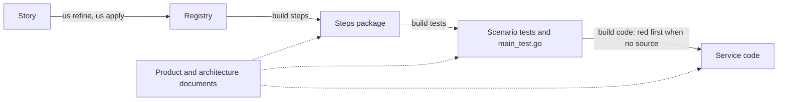

# Roadmap

> Historical whiteboard companion: [`roadmap.html`](./roadmap.html) — the original board, before the pipeline order of ADR-0040.
>
> Transcribed from the **"Idea"** whiteboard as it stood on 2026-08-21. This file is now the
> source.

## The goal, in one sentence per step

The whole product, stated as what a person does rather than what the engine does:

1. **I have Idea**
2. **I create user story with all artifacts and scenarios**
3. **I build steps**
4. **I build tests**
5. **I build code**
6. **It works**

Every milestone below is a step toward making that list run end to end without a person
writing the middle of it.

## The pipeline

The order is `us refine`, `us apply`, `build steps`, `build tests`, `build code` (ADR-0040). The Specification supplies every command's evidence; each command writes its own artifact.



`build steps` writes and checks the Steps package before any test exists. `build tests` renders the tests and their main file in one deterministic pass, refusing without that package and holding the two host folder checks. `build code` lists and runs the Go suite first when a service has no source: every Scenario of that service must fail at an executed definition. A green Scenario stops it distinctly, naming the Scenario; with code present, it proceeds to the Failing set. The repository's generated-suite gate runs `build tests` without `--fix`, and its fixture gate holds the two repository fixture contracts.

## What `build` means

The board draws `build` as a single transform with two inputs and one output:

```text
   ┌──────────────────────────────────────────────────────── Build ───────┐
   │                                                                      │
   │   Tests                                                              │
   │     • playwright                     ╲                               │
   │     • LLMs                            ╲                              │
   │                                        ╲    Make tests pass          │
   │   Architecture                          ────  following        ──▶   │   src/
   │     • docker-compose.yaml               ╱    architecture            │     • service1
   │     • architecture.yaml                ╱                             │     • service2
   │         • services1                   ╱                              │     • service3
   │             • path                                                   │
   │             • initial config                                         │
   │             • tech stack                                             │
   │         • initial configuration                                      │
   └──────────────────────────────────────────────────────────────────────┘
```

Tests say **what must be true**; the architecture says **where the code may go and what it
may be built with**. The build step is the one that has to satisfy both at once — it may not
make a test pass by putting code somewhere the architecture does not declare.

Note that `Tests` here has two members, `playwright` and `LLMs`. A test is not assumed to be
a thing a regexp can settle; some of what must hold is checked by a model. That is the same
split the harness draws between step definitions and the `llm:` / `judge:` prefixes.

## Milestones

Four cards, left to right, two of them already ticked on the board.

### 1. I have code and Playwright / CLI tests — ✅ done

The starting position: a working system with a real test suite, written by hand.

### 2. I can generate code from tests — ✅ done

`build code` closes the loop from a failing test to production source. This is the milestone
that proved the direction: if the tests are the specification, the code is derivable.

### 3. I can generate GWT tests from `scenarios.yaml` — ⬜ open

Given/When/Then tests rendered from the registry rather than authored — the registry stops
being a document *about* the tests and becomes the thing they are generated from.

### 4. Create remaining scenarios with all artifacts — ⬜ open

- **Create remaining scenarios with all artifacts:** vocabulary, features, steps, etc.
- **I can generate GWT tests, steps, judgements from `scenarios.yaml`.**

The difference from milestone 3 is the word **steps**. Milestone 3 generates the test; this
one generates the step definitions the test binds to, and the judgements that grade what no
comparison can settle. When this lands, a scenario written in the registry is executable
without anyone opening a `.go` file.

## Where the repo stands against this

Derived from the tree and `CLAUDE.md`, not from the board — the board records intent, this
records the current position.

| Milestone | Position |
|---|---|
| 1 — code + tests exist | Done. Every true-bdd Scenario drives a fixture tree of its own. |
| 2 — generate code from tests | Done. `build code` walks each suite's declared `replay` command and drives a fix turn per failure. |
| 3 — generate GWT tests | Done. `build tests` renders one `func Test<Key>` per scenario into the file that scenario's `path:` names — deterministic codegen, verified without `--fix` by regenerating and comparing. It covers every Registry Scenario. |
| 4 — scenarios → tests + steps + judgements | **Partly done.** `build tests --fix` authors a step definition per gap, and that mechanism works: every step of every registry scenario binds, so all of them are rendered *and* runnable. Judgements: the `judge:` prefix exists and the Scenarios that need a model's ruling use it. Vocabulary and features: done for this repository — the product document holds the forbidden `vocabulary:`, the `concepts:` and the `glossary:`, every Scenario belongs to a Story and is keyed by its lineage (ADR 0014), each Story carries a `feature:`, and `scen check` holds every Scenario to them. |

That number is now zero: every step of every Registry Scenario binds, and `build tests`
on this repository dispatches no AI turn at all.
Step coverage itself stopped being a test — the engine reads the `steps/` packages
directly, so there is no step-coverage gate to join.

## Decision log

- **The board's five-step list is written in the first person on purpose.** It is the user's
  experience of the product, not the engine's control flow — which is why "It works" is a step
  rather than an outcome. A roadmap phrased as engine stages would have hidden that the whole
  point is what the person does not have to do.
- **`scenarios.yaml` appears twice in the pipeline drawing** — once as a loose document at the
  top, once as `us apply`'s output. Same file. The loose one is the registry as an input the
  author may already have; the connected one is the registry as the thing `us apply` writes.
- **Milestones 3 and 4 are separate cards even though both say "generate GWT tests".** Splitting
  them is the useful part: 3 is generating the test, 4 is generating what the test binds to.
  Collapsing them would hide that the first is deterministic codegen and the second needs a model.
